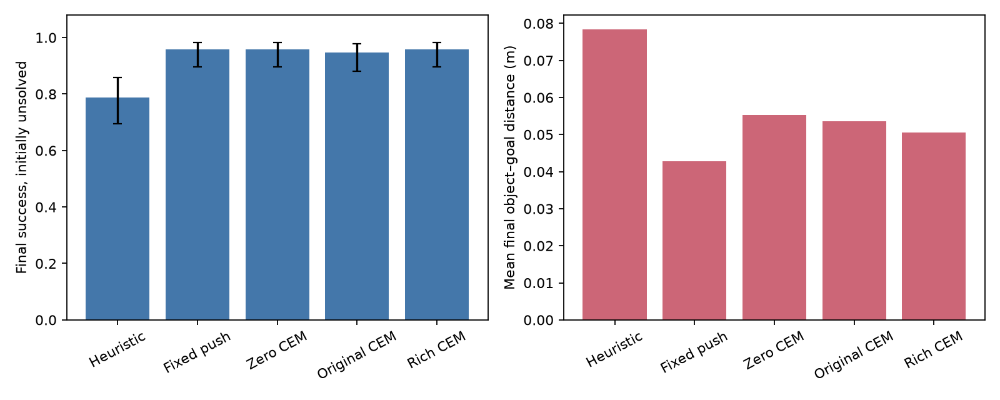
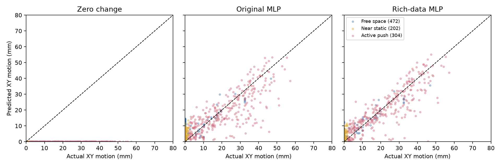
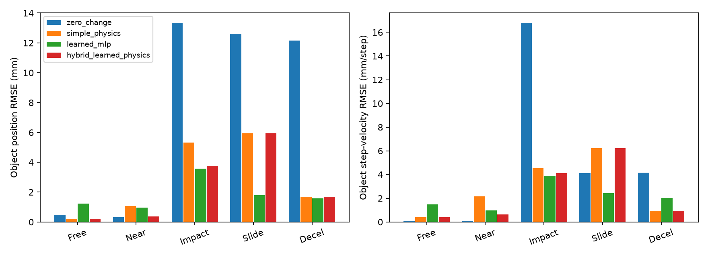
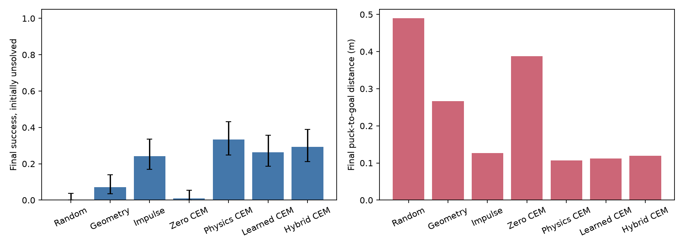

# Learning Robot Dynamics for Model-Based Manipulation

A small, CPU-first research implementation of a **state-based** world model for `FetchPush-v4`. A neural network learns one-step robot and object dynamics from MuJoCo trajectories. Cross-Entropy Method (CEM) model predictive control (MPC) searches action sequences under that learned model and replans after every real simulator step. This is a simulation study; no physical robot or sim-to-real result is claimed.

## Quick start

```bash
python3.12 -m venv .venv
source .venv/bin/activate
pip install -r requirements-lock.txt
pip install -e .
rwm probe --gif results/probe.gif
rwm collect --episodes 18 --seed 7 --steps 50
rwm train --epochs 35 --seed 7
rwm predict
rwm evaluate --seeds 100 101 102 --gif results/mpc.gif
pytest -q
```

`rwm probe` checks reset, one step, reward, spaces, and optional RGB rendering. If graphics are unavailable, omit `--gif`; physics, training, and planning can still run headlessly. The small reference dataset, checkpoint, plot, metrics, and MPC GIF are committed; new smoke outputs stay local.

For a faster end-to-end check, run `bash scripts/smoke.sh`. It uses 12 episodes, 18 training epochs, two evaluation seeds, and a smaller CEM search.

**Phase 2:** `bash scripts/phase2.sh` regenerates the larger dataset, model, regime diagnostics, four-policy comparison on 30 held-out seeds, and tests. It takes minutes on the tested M1 Pro CPU. To inspect the committed results immediately, open the linked artifacts below.

## Observation and action contract

The environment returns a dictionary: `observation` (25 floats), `achieved_goal` (current object XYZ), and `desired_goal` (target object XYZ). The action is `[gripper_dx, gripper_dy, gripper_dz, gripper_command]`, each in `[-1,1]`. The gripper is locked for FetchPush, so the fourth command is always zero here. Sparse reward is `0` inside 5 cm of the goal and `-1` otherwise. One environment step runs 20 MuJoCo substeps (0.04 s total).

| Raw `observation` indices | Meaning |
| --- | --- |
| 0–2 | Gripper Cartesian XYZ position in world coordinates (m) |
| 3–5 | Object Cartesian XYZ position in world coordinates (m) |
| 6–8 | Object position relative to gripper (m) |
| 9–10 | Right and left gripper finger joint displacements (m) |
| 11–13 | Object XYZ Euler orientation (rad) |
| 14–16 | Object linear velocity relative to gripper, scaled by step duration |
| 17–19 | Object angular velocity, scaled by step duration |
| 20–22 | Gripper linear velocity, scaled by step duration |
| 23–24 | Finger velocities, scaled by step duration |

The model uses a 12-D state: gripper XYZ, object XYZ, object XYZ *per-step displacement*, and gripper XYZ *per-step displacement*. Absolute object displacement is raw indices `14:17 + 20:23`. This drops redundant relative positions and the locked finger state. The goal is stored with transitions and enters the controller cost; it is never a model input. The 12-D observation omits some joint and contact details, so its dynamics need not be perfectly Markovian.

## Learning and planning

`data.py` records `(state, action, next_state, goal, episode_id, episode_seed, timestep, sampler)` from real FetchPush rollouts. One third of episodes use uniform random Cartesian actions; the rest use a noisy push heuristic that approaches behind the block. Whole episodes are assigned to train, validation, or test, preventing adjacent transitions from crossing splits.

`model.py` learns a residual: `s_hat[t+1] = s[t] + MLP(normalize([s[t], a[t]])) * delta_std + delta_mean`. All normalization statistics are fit on training episodes only. The checkpoint stores weights and statistics together; validation loss selects the best epoch. `prediction.py` compares held-out one-step RMSE with a zero-change predictor and measures open-loop object position RMSE after five real recorded actions, with no state correction between predictions.

`mpc.py` samples bounded action sequences, rolls them forward **only through the learned MLP**, scores predicted object-to-goal distance plus hand designed gripper placement and action costs, and updates the CEM sampling distribution using its best candidates. It executes only the first chosen action in MuJoCo, observes the result, and replans. The planner never queries hidden simulator futures. `rwm evaluate` runs random, heuristic, and learned MPC policies from identical test reset seeds, reporting final success, final distance, and planning time. Model bias and compounding error can make learned MPC worse than the heuristic; retain that result as evidence.

Phase 2 preserves this original controller and checkpoint. `phase2.py` adds four episode-level samplers: random, goal-directed with a stop inside the goal, near-contact action perturbations, and deliberately aggressive pushes. The data also records MuJoCo gripper/object contact at the **end** of each environment step and a separate moving-push label (object moves >2 mm while the gripper is within 10 cm). The latter catches short contacts during the 20 internal substeps, but is an operational proxy rather than an exact collision trace. All split assignments are by episode and stratified by sampler.

`improved_mpc.py` uses current observed geometry to move the gripper 5.5 cm behind the object, descends to about 1.5 cm above its center, and then uses CEM over a restricted forward-push action family. **Every candidate future in the push phase is predicted by the learned MLP.** The hand designed cost rewards goal progress and contact geometry and penalizes predicted object motion when the gripper is far away. This is a hybrid geometric approach plus learned-model MPC push controller; its success cannot be attributed solely to learned dynamics. MuJoCo is never queried for candidate future states.

## Phase 1 reference results

Measured on an Apple M1 Pro CPU with Python 3.12, PyTorch 2.14.1, MuJoCo 3.4.0, and Gymnasium-Robotics 1.4.2. The reference run collected 18 episodes × 50 steps = 900 transitions (600 train / 150 validation / 150 test), seeded at 7. About 30.8% of transitions had the gripper within 6.5 cm of the object. The best checkpoint was epoch 30 of 35, with normalized validation MSE 0.2868.

| Held-out prediction | Error |
| --- | ---: |
| Learned model, one-step object position RMSE | 0.00469 m |
| Zero-change baseline, one-step object position RMSE | 0.01273 m |
| Learned model, five-step open-loop object position RMSE | 0.03162 m |

Closed-loop policy comparison used identical reset seeds 100, 101, 102 and 50 steps per episode. These three episodes are a smoke test, not a reliable success-rate estimate.

| Policy | Final success | Mean final object-goal distance | Time to plan each step | Fraction of steps within 6.5 cm of object |
| --- | ---: | ---: | ---: | ---: |
| Random | 0/3 | 0.1783 m | — | 0.000 |
| Push heuristic | 0/3 | 0.1063 m | — | 0.653 |
| Learned dynamics + CEM-MPC | 0/3 | 0.1802 m | 2.39 ms | 0.073 |

The learned MPC executed real actions but rarely brought the gripper close enough to the object. Its short model horizon and imperfect contact predictions likely let the optimizer favor actions that look useful in the model but do not produce physical contact. The heuristic contacted and moved the object much more often, yet also failed to reach the 5 cm success threshold; its repeated approach/push rule can overshoot or oscillate. The initial 12-episode smoke model was worse still: one-step object RMSE 0.0251 m versus 0.0148 m for zero change, and five-step RMSE 0.1974 m. Its held-out episodes differ from the 18-episode run, so this is a warning about small-sample instability rather than a controlled learning-curve comparison.

Artifacts: [sample dataset](data/small.npz), [model checkpoint](results/dynamics.pt), [training history](results/train.json), [prediction metrics](results/prediction.json), [ground-truth comparison plot](results/prediction.png), [policy evaluation](results/evaluation.json), and [MPC rollout GIF](results/mpc.gif). These are genuine results from the commands above, including failures.


## Phase 2 diagnosis and results

On developer seeds 200–204, the original MPC predicted 3.35 mm mean object motion per **free-space** action while the simulator produced only 0.14 mm; 21% of such steps predicted >5 mm while actual motion was <1 mm. Its 8-step horizon also spans approach, descent, and push, leaving little lookahead for useful contact. The original heuristic sometimes entered the 5 cm success region and then pushed the object out again. A 4.5 cm stopping margin made the corrected heuristic succeed on 18/20 developer seeds 200–219. No final test seed was used to choose the controller or training recipe.

The phase-2 collection used seed 5000 and 120 episodes: 5,029 transitions (3,048 train / 1,003 validation / 978 test), including 1,947 moving-push transitions and 507 end-step MuJoCo contact detections. The model architecture and 35-epoch training schedule stayed the same, isolating the main data change. A tested contact-weighted objective only marginally improved validation near-contact error and slightly worsened free-space error, so the final model uses the original unweighted loss.

The table evaluates **both models on the same rich-data test episodes**. Zero-change is computed on those same transitions. Multi-step predictions use recorded actions but never reset the model to real intermediate states.

| Object position RMSE | Zero-change | Original model | Rich-data model |
| --- | ---: | ---: | ---: |
| One-step, all (978) | 11.65 mm | 5.09 mm | 3.98 mm |
| One-step, free space (472) | 10.67 mm | 4.81 mm | 3.43 mm |
| One-step, near-contact static (202) | **0.39 mm** | 2.84 mm | 2.13 mm |
| One-step, actual pushing (304) | 16.13 mm | 6.49 mm | 5.46 mm |
| Five-step, all (883 windows) | 49.99 mm | 35.18 mm | 26.49 mm |
| Five-step, starts in pushing (274) | 73.88 mm | 45.04 mm | 37.47 mm |

The near-contact static row remains a clear model failure: both MLPs hallucinate some motion when the block stays still. Five-step push error is still much larger than one-step error, so CEM can remain sensitive to model bias. The [full prediction metrics](results/phase2_prediction.json) include motion calibration and the other five-step regimes.

To separate model and planner effects, a [2 × 2 ablation](results/phase2_dev_ablation.json) used only developer seeds 200–219:

| Planner / model | Final success | Mean final distance |
| --- | ---: | ---: |
| Original CEM / original model | 5/20 | 0.1367 m |
| Original CEM / rich-data model | 13/20 | 0.1046 m |
| Contact-aware CEM / original model | 20/20 | 0.0264 m |
| Contact-aware CEM / rich-data model | 20/20 | 0.0272 m |

Thus the staged approach and contact-aware action search explain most of the observed control improvement on these developer seeds. The richer dataset improves prediction and helps the original planner, but these experiments do **not** establish that the richer model is necessary for the improved planner's success. No 2 × 2 ablation was run on final test seeds.

The final policy test used the **same 30 reset seeds, 1000–1029**, with 50 steps per episode. Two resets were already inside the 5 cm goal threshold; the corrected success rate excludes those two.

| Policy | Final success | New successes / 28 initially unsolved | Final distance | Near-object steps (<6.5 cm) | MuJoCo end-step contact | Planning time |
| --- | ---: | ---: | ---: | ---: | ---: | ---: |
| Random | 2/30 | 0/28 | 0.1581 m | 0.8% | 0.0% | — |
| Corrected heuristic | 24/30 | 22/28 | 0.1008 m | 24.1% | 5.9% | — |
| Original learned MPC | 4/30 | 2/28 | 0.1576 m | 17.1% | 8.8% | 2.23 ms/step |
| Improved learned MPC | **28/30** | **26/28** | **0.0648 m** | 44.6% | 6.7% | 0.40 ms/step overall |

The improved controller runs CEM only while pushing; its mean across **172 actual push-planning steps** is **3.42 ms**. The lower overall figure includes cheap approach and hold steps. The two failed test seeds, 1003 and 1029, ended 0.566 m and 0.674 m from the goal; after large block displacement the controller spent most of the remaining episode trying to reapproach. The heuristic achieved success at some point in 28/30 episodes but ended successful in 24/30, showing why final success and transient success must be distinguished. These are simulation-only results on 30 seeds, not a guarantee of robust control.

Phase-2 artifacts: [dataset](data/rich.npz), [model](results/rich.pt), [training history](results/phase2_train.json), [prediction comparison](results/phase2_prediction.json), [four-policy evaluation](results/phase2_evaluation.json), [regime error plot](results/phase2_regimes.png), [test trajectory plot](results/phase2_trajectories.png), and [improved MPC GIF](results/phase2_mpc.gif).


## Phase 3: does the learned model improve planning?

Run `bash scripts/phase3.sh` with the existing phase-1 and phase-2 checkpoints/data. It evaluates prediction on the held-out rich-data episodes, runs a 10-seed developer check (300–309), then runs the **predeclared final seeds 20000–20099 once**. These 100 seeds did not overlap the training collection (5000–5119), phase-2 developer seeds (200–219), phase-2 test seeds (1000–1029), or phase-3 developer seeds. All controllers receive the same 50-step reset, action bounds, goal and success rule. The staged controllers share exactly the same observed-state approach/descend/hold function. Their push stage differs: fixed 0.8 forward action; or CEM with the literal zero-change, original, or rich-data dynamics model. All three CEMs use horizon 10, 64 candidates and 3 iterations, with the same per-episode random seed. The simple heuristic is the phase-2 no-model controller. No planner queries MuJoCo candidate futures.

Six of the 100 resets already met the 5 cm threshold. The main success denominator excludes those six; the overall count includes them. Wilson 95% intervals describe uncertainty in each success rate. Runtime is Python action-selection wall time on the same M1 Pro CPU; fixed controllers have no CEM search. `Near` is gripper/object center separation <6.5 cm; `contact` is collision at the final MuJoCo substep; `moving push` is the motion-and-proximity proxy described above.

| Controller | New final success / 94 (95% CI) | Overall / 100 | Final distance | Near | End-step contact | Moving push | Action time |
| --- | ---: | ---: | ---: | ---: | ---: | ---: | ---: |
| Heuristic | 74/94 (69.4–85.8%) | 79 | 78.3 mm | 27.1% | 6.7% | 30.4% | 0.015 ms |
| Shared approach + fixed push | **90/94 (89.6–98.3%)** | 96 | **42.9 mm** | 36.3% | 5.0% | 21.9% | 0.008 ms |
| Shared approach + zero-change CEM | 90/94 (89.6–98.3%) | 96 | 55.2 mm | 75.7% | 8.6% | 30.5% | 0.501 ms |
| Shared approach + original-model CEM | 89/94 (88.1–97.7%) | 95 | 53.6 mm | 43.7% | 5.9% | 23.0% | 0.467 ms |
| Shared approach + rich-model CEM | 90/94 (89.6–98.3%) | 96 | 50.5 mm | 43.7% | 4.8% | 22.3% | 0.426 ms |

Success and mean distance tell different, compatible stories: fixed push, zero-change CEM and rich-model CEM fail on the **same four seeds**; among their successful episodes, mean distances are 17.6, 30.5 and 25.6 mm respectively. The rich model improves precision over zero-change CEM, but fixed push is more precise still. One initially successful reset ends outside the goal under the heuristic, explaining its 79 overall successes versus 74 new successes plus six initially successful resets.

On the 94 paired initially unsolved seeds, rich-model versus zero-change CEM has **0 net success difference** (zero discordant pairs; exact two-sided McNemar p=1), and rich versus fixed push also has **0 net success difference**. Rich versus original-model CEM gains one seed (exact p=1; insufficient evidence of a rate gain). Rich versus the older heuristic gains 16 seeds (exact p=3.05×10⁻⁵), but this compares different push mechanisms and cannot isolate model value. Paired bootstrap 95% intervals for mean final distance differences (rich minus baseline) are **−7.38 to −2.28 mm** versus zero-change, **+4.93 to +11.24 mm** versus fixed push, and **−15.20 to +3.64 mm** versus original-model CEM. The bootstrap uses 10,000 paired seed resamples with fixed seed 104; these intervals are descriptive, and secondary comparisons were not used to select a model.

The models do learn object motion on held-out trajectories, even though this does not yield more successes with the staged controller:

| Object XYZ RMSE on rich-data test episodes | Zero-change | Original MLP | Rich-data MLP |
| --- | ---: | ---: | ---: |
| One step, all 978 transitions | 11.65 mm | 5.09 mm | **3.98 mm** |
| Free space, 472 | 10.67 mm | 4.81 mm | **3.43 mm** |
| Near static, 202 | **0.39 mm** | 2.84 mm | 2.13 mm |
| Active pushing, 304 | 16.13 mm | 6.49 mm | **5.46 mm** |
| End-step MuJoCo contact, 72 | 10.95 mm | 5.49 mm | **5.10 mm** |
| Five-step open loop, 883 windows | 49.99 mm | 35.18 mm | **26.49 mm** |

During active pushing, actual mean object XY displacement is 22.11 mm per step; the original and rich models predict 19.29 and 20.51 mm. In near-contact *static* states, however, both models hallucinate millimeters of motion while the zero-change predictor is nearly perfect. Five-step error is still much larger than one-step error. The 12-D state also omits detailed contact and joint configuration. This combination can mislead longer-horizon optimization even when one-step RMSE looks good.

Replacing the push model changes actions on identical first-push observations: across 92 matched seeds that reached the push stage, the mean L2 difference from the rich-model action is 0.264 for fixed push, 0.437 for zero-change CEM and 0.243 for original-model CEM. These changes do **not** create a success advantage over fixed push or zero-change CEM. The common geometric approach and the simplicity of straight-line FetchPush likely dominate the 5 cm binary outcome. This study establishes a prediction improvement and a modest precision gain over the zero predictor; it does **not** establish a learned-world-model contribution to task success, necessity of contact prediction for this controller, or transfer beyond simulation. A future study should first choose a task that requires nontrivial action sequence prediction and preserve strong non-learned baselines; that is outside this phase.

Artifacts: [raw five-policy results and paired comparisons](results/phase3_final_evaluation.json), [prediction metrics](results/phase3_prediction.json), [controller comparison](results/phase3_controllers.png), [regime comparison](results/phase3_prediction.png), [per-transition predicted-versus-actual motion](results/phase3_motion_scatter.png), and [developer check](results/phase3_dev_evaluation.json).





## Phase 4: predicting momentum in FetchSlide

FetchSlide-v4 asks the robot to hit a puck across a low-friction table, often toward a goal outside its workspace. The [official environment contract](https://robotics.farama.org/envs/fetch/slide/) specifies a 25-D observation, four bounded actions, 25 Hz control, and sparse success within 5 cm. `slide_env.py` verifies these on the installed v4 environment. The Slide model uses **15 observed coordinates**: gripper XYZ, puck XYZ, absolute puck XYZ displacement per 0.04 s step, gripper XYZ displacement per step, and puck angular displacement per step. The original Push state already contained linear velocity; Slide explicitly retains it and adds angular velocity. Goal coordinates are never a dynamics input. A puck with nonzero velocity continues moving under zero action, so position alone cannot describe its future. The 15-D state still omits exact collision geometry and may not be fully Markovian.

```bash
source .venv/bin/activate
bash scripts/phase4.sh
```

The script probes FetchSlide, collects 200 seeded episodes (10,000 transitions), fits an analytic impact/friction baseline on **training episodes only**, trains a 15-D residual MLP for 45 epochs, evaluates held-out predictions, checks controllers on developer seeds 400–429, and evaluates once on the **frozen final seeds 30000–30099**. The 100 final seeds do not overlap collection seeds 6000–6199 or the developer seeds. Rendering the GIF needs a working local MuJoCo graphics context; the headless experiments are independent of rendering. Individual commands use `python -m robot_world_model.slide_experiment {probe,collect,train,predict,dev,final,demo}`.

Five episode-level samplers cover random exploration, geometry pushes, velocity-aware impulses, perturbed impacts, and impulse-followed-by-coasting. Collection uses the frozen exploratory impulse sampler; the later velocity cutoff applies to control evaluation. Regenerating all 200 episodes produced arrays identical to the committed dataset, and retraining reproduced every checkpoint tensor. Splits contain 6,000 train / 2,000 validation / 2,000 test transitions, with whole episodes isolated. The data contain 235 offline impact-proxy steps and 5,331 sliding steps; the 40 held-out episodes contain 49 and 1,057. `impact` means an end-step MuJoCo collision **or** a >3 mm/step velocity jump with the gripper within 11 cm. The latter detects impacts that occur between the 20 simulator substeps but is not a collision ground truth. `sliding` and `decelerating` are observable motion labels. The MLP training loss weights impacts 8× and sliding 2×; all normalizers use training episodes only.

The analytic model fits three gripper action gains, a sliding speed decrement (1.43 mm per control step), and a normal impulse gain (1.72) on training transitions. Zero-change, analytic physics, and MLP use the **same** CEM search during the strike phase: 25-step horizon, 48 candidates, two iterations, and identical random seeds, action constraints, cost, approach/descend/coast logic, and environment resets. CEM scores predicted stopping position, endpoint distance, residual speed, implausible distant object motion, and action effort. It executes one real action and replans; MuJoCo is used only for real stepping and offline evaluation. The geometry and handcrafted impulse baselines use no world model. An exploratory hybrid uses the MLP for closing contact and analytic friction for free coasting; it is reported separately from pure MLP MPC.

### Held-out prediction

Object XYZ error on the **same 2,000 test transitions**; one-step errors are per-coordinate RMSE. The stopping row measures mean XY distance between predicted and observed final resting position on 28 held-out episodes with an impact, at least five subsequent steps, and final speed <3 mm/step. Open-loop rollouts use recorded actions without correcting intermediate model states.

| Metric | Zero change | Analytic physics | Learned MLP | Exploratory hybrid |
| --- | ---: | ---: | ---: | ---: |
| One-step object position RMSE | 9.41 mm | 4.43 mm | **1.61 mm** | 4.37 mm |
| Impact position RMSE (49 steps) | 13.34 mm | 5.32 mm | **3.58 mm** | 3.77 mm |
| Impact velocity RMSE | 16.80 mm/step | 4.52 | **3.89** | 4.13 |
| Five-step object position RMSE | 46.0 mm | 20.9 mm | **10.6 mm** | 19.9 mm |
| Twenty-step object position RMSE | 162.7 mm | 86.2 mm | 80.8 mm | **65.5 mm** |
| Final stopping-position error (28 episodes) | 515.1 mm | **76.2 mm** | 266.4 mm | 76.2 mm |

The MLP learns impact and immediate sliding motion; its 1-step error is substantially lower than the physics baseline. Yet small velocity and direction biases compound during long free coasts. Its predicted final stop is much worse than the analytic friction model's, despite its lower short-horizon RMSE. The [open-loop trajectory](results/slide_prediction_trajectory.png) illustrates this difference on held-out data, not on a control test seed.

### Matched controller test

All controllers received the same 100 resets and 50 controlled steps. One reset was already successful; the main denominator excludes it. Each overall-success count is the table's new-success count plus one. After step 50, every environment received **50 zero actions** to measure physical stopping position separately from final controlled-step success; all resulting puck speeds were below 3 mm/step. `Ever` counts any transient success during control and must not be read as final success. Wilson intervals for final success and all per-seed outcomes are in the [raw evaluation](results/slide_final_evaluation.json).

| Controller | New final successes / 99 | Ever / 100 | Mean final distance | Mean settling error | Impact proxy | End-step contact | Action time |
| --- | ---: | ---: | ---: | ---: | ---: | ---: | ---: |
| Random | 0 | 1 | 489 mm | 492 mm | 1.0% | 0.6% | 0.008 ms |
| Geometry heuristic | 7 | 58 | 266 mm | 295 mm | 2.0% | 0.4% | 0.012 ms |
| Handcrafted impulse | 24 | 61 | 127 mm | 152 mm | 2.2% | 0.8% | 0.015 ms |
| Zero-change CEM | 1 | 2 | 388 mm | 351 mm | 2.5% | 1.1% | 0.669 ms |
| Analytic physics CEM | **33** | 69 | **107 mm** | 136 mm | 2.2% | 0.9% | 0.287 ms |
| Learned MLP CEM | 26 | 41 | 112 mm | **116 mm** | 4.0% | 1.7% | 0.397 ms |
| Exploratory hybrid CEM | 29 | 60 | 119 mm | 145 mm | 2.3% | 0.7% | 0.476 ms |

For the primary paired comparison, learned minus analytic-physics CEM success is **−7.1 percentage points** (paired bootstrap 95% CI −18.2 to +4.0; exact McNemar p=0.281). Learned minus handcrafted impulse is +2.0 points (CI −10.1 to +14.1; p=0.868). Neither establishes a success advantage. Learned beats zero-change by 25.3 points (CI +17.2 to +34.3; p<10⁻⁶), showing that some dynamics prediction is essential for this CEM implementation, but the analytic model supplies it without an MLP. On the same initial first-strike observations, learned and analytic CEM commands differ by mean action L2 0.189, confirming that model substitution changes planning behavior.

Mean *observed* settling error is 19.7 mm lower for learned than analytic CEM, but its paired 95% interval (−46.2 to +5.4 mm) spans zero. Versus handcrafted impulse it is 36.2 mm lower (exploratory paired interval −64.1 to −10.0 mm); this secondary endpoint was examined after the main success comparison. Physics CEM attains the best mean final distance and highest point-estimate success. Geometry's 58 transient versus seven final successes reveal severe overshoot. Thus the learned model predicts impacts more accurately and affects actions, but **this experiment does not establish that it improves final task success over strong non-learning alternatives**. Its long-coast stopping bias is a plausible reason; controller timing and task variability may also matter. These are simulation results only.

Artifacts: [dataset](data/slide.npz), [model checkpoint](results/slide.pt), [training and physics fit](results/slide_training.json), [prediction metrics](results/slide_prediction.json), [phase error plot](results/slide_prediction.png), [predicted versus actual trajectory](results/slide_prediction_trajectory.png), [matched controller results](results/slide_final_evaluation.json), [controller comparison](results/slide_controllers.png), [control trajectories](results/slide_trajectories.png), and [real MuJoCo MPC GIF](results/slide_learned_mpc.gif). The GIF shows a successful **developer-seed** rollout; it is not used as a success-rate estimate.






## Source and license

Original project code is MIT licensed; see [LICENSE](LICENSE). The environments are [Gymnasium-Robotics FetchPush](https://robotics.farama.org/envs/fetch/push/) and [FetchSlide](https://robotics.farama.org/envs/fetch/slide/) (MIT), based on [Plappert et al., 2018](https://arxiv.org/abs/1802.09464). Physics uses [MuJoCo](https://mujoco.readthedocs.io/) (Apache 2.0). PyTorch supplies the MLP. These dependencies are installed separately and are not copied into this repository.
