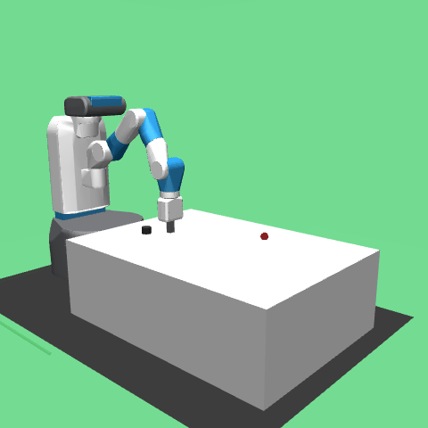

# Learning Robot Dynamics for Model-Based Manipulation

**Research question:** Does a learned, state-based forward dynamics model improve robotic planning when it predicts object motion more accurately? We study this in MuJoCo `FetchPush-v4` and momentum-sensitive `FetchSlide-v4` with episode-isolated datasets, residual PyTorch MLPs, and Cross-Entropy Method (CEM) model predictive control (MPC). All experiments are simulation only.

**Main finding:** **Improved one-step dynamics prediction does not necessarily improve long-horizon robotic control.** On FetchPush, a fixed geometric push matched learned MPC's success. On FetchSlide, the learned model had lower one-step and impact error than a fitted analytic model, but analytic-physics MPC achieved a higher final success point estimate. We retain those comparisons and all unsuccessful episodes.



[FetchSlide prediction by motion phase](results/slide_prediction.png) · [Predicted versus observed slide](results/slide_prediction_trajectory.png) · [FetchSlide controller comparison](results/slide_controllers.png) · [FetchPush controller comparison](results/phase3_controllers.png) · [FetchPush MPC demo](results/phase2_mpc.gif)

## Method

The environment provides a 25-float observation, an observed goal, and four actions in `[-1, 1]`. Our **Push state has 12 coordinates**: gripper XYZ, object XYZ, absolute object XYZ velocity and gripper XYZ velocity, each multiplied by the 0.04 s control interval. **Slide adds three object angular step velocities** for a 15-coordinate state. Fetch reports object linear velocity relative to the gripper. In step-scaled units, absolute object velocity is `observation[14:17] + observation[20:23]`. [Push state extraction](src/robot_world_model/env.py) and [Slide state extraction](src/robot_world_model/slide_env.py) implement this contract. These are end-of-step velocities scaled by 0.04 s, not exact position differences across the previous step. Both states omit exact contact and joint configuration; they are useful compact observations, not guaranteed Markov states.

The [dynamics MLP](src/robot_world_model/model.py) maps `(state, action)` to a normalized state increment:

```text
ŝₜ₊₁ = sₜ + σΔ · MLP((concat(sₜ, aₜ) − μin) / σin) + μΔ
```

It has two 128-unit ReLU hidden layers. Input and target normalization use **training episodes only**; validation loss selects the checkpoint. Goals are stored with transitions for control and evaluation, but never enter the dynamics model. [Push collection](src/robot_world_model/data.py) and [Slide collection](src/robot_world_model/slide_data.py) split whole episodes among train, validation, and test.

CEM samples bounded candidate actions, rolls each sequence through the **selected predictor**, scores predicted goal distance and hand-designed costs, executes one action in MuJoCo, then replans from the next observation. [Push CEM](src/robot_world_model/improved_mpc.py) and [Slide CEM](src/robot_world_model/slide_mpc.py) share a geometric approach stage across their model ablations. Slide CEM scores predicted stopping position, residual speed, distant-motion artifacts, and action effort. MuJoCo supplies actual observations and offline labels; it is never queried for candidate futures during MPC. The [simple physics baseline](src/robot_world_model/slide_physics.py) fits impulse and friction parameters on training episodes only.

## Results from saved experiments

**FetchPush:** 100 previously unused test resets (seeds 20000–20099), 50 steps each; six were already inside the 5 cm success region. The principal rate counts *new final successes* among the remaining 94. All controllers have matched initial conditions. CEM variants use the same 10-step horizon, 64 candidates, three iterations, action bounds, approach rule, and per-episode sampling seed.

| Controller | New final success | Mean final distance |
| --- | ---: | ---: |
| Heuristic | 74/94 | 78.3 mm |
| Shared approach + fixed push | **90/94** | **42.9 mm** |
| Shared approach + zero-change CEM | 90/94 | 55.2 mm |
| Shared approach + original-MLP CEM | 89/94 | 53.6 mm |
| Shared approach + rich-data-MLP CEM | 90/94 | 50.5 mm |

On 978 held-out rich-data transitions, object-position one-step RMSE was **11.65 mm** for zero change, **5.09 mm** for the original MLP, and **3.98 mm** for the rich-data MLP. On 304 active-pushing transitions it was 16.13, 6.49, and 5.46 mm respectively. Rich-model and fixed-push controllers succeeded on the *same* 90 initially unsolved seeds. The rich model improved prediction without demonstrating a success-rate gain over the matched fixed push or zero-change CEM. [Prediction diagnostics](results/phase3_prediction.json) · [Paired controller records and Wilson intervals](results/phase3_final_evaluation.json) · [Contact error figure](results/phase3_prediction.png).

**FetchSlide:** 100 previously unused test resets (seeds 30000–30099), 50 controlled actions and 50 identical zero-action settling steps; one reset was initially successful. Main rates count *new final successes* among 99 initially unsolved episodes. The three principal CEM variants share the same observed-state approach, 25-step horizon, 48 candidates, two iterations, action constraints, cost, and per-episode sampling seed.

| Controller | New final success | Mean final distance | Mean observed settling error |
| --- | ---: | ---: | ---: |
| Geometry heuristic | 7/99 | 266 mm | 295 mm |
| Handcrafted impulse | 24/99 | 127 mm | 152 mm |
| Zero-change CEM | 1/99 | 388 mm | 351 mm |
| Fitted analytic-physics CEM | **33/99** | **107 mm** | 136 mm |
| Learned-MLP CEM | 26/99 | 112 mm | **116 mm** |
| Exploratory hybrid CEM | 29/99 | 119 mm | 145 mm |

Random control had 0/99 new final successes. On 2,000 held-out transitions, object-position one-step RMSE was **9.41 mm** for zero change, **4.43 mm** for analytic physics, and **1.61 mm** for the MLP. On 49 impact-proxy transitions the corresponding errors were 13.34, 5.32, and 3.58 mm. Yet the mean predicted final stopping-position error on 28 eligible held-out episodes was **266.4 mm for the MLP versus 76.2 mm for physics**. Learned minus physics MPC final success was −7.1 percentage points (paired bootstrap 95% interval −18.2 to +4.0; exact McNemar p=0.281). The MLP changes first-strike actions, but these data do **not** establish a success advantage over analytic physics or the handcrafted impulse baseline. [Prediction records](results/slide_prediction.json) · [Per-seed controller records, contact and runtime metrics, confidence intervals](results/slide_final_evaluation.json) · [Controller figure](results/slide_controllers.png).

**Failure analysis:** Near-contact static Push states can induce false motion in the MLP; five-step Push errors exceed one-step errors. Slide impact is predicted better by the MLP, but small velocity bias compounds over long coasts and its stopping-position forecast is poor. Slide geometry reached the goal transiently in many episodes but overshot: transient entry is recorded separately from final success. FetchPush's shared geometric approach and simple straight push explain why model replacement barely changed its binary outcome. None of these experiments demonstrates sim-to-real transfer, a video-generative world model, or a statistically established learned-model control advantage over strong non-learning baselines.

## Reproduce

Tested on Apple M1 Pro, macOS arm64, Python 3.12, CPU. From the repository root:

```bash
python3.12 -m venv .venv
.venv/bin/python -m pip install -r requirements-lock.txt
.venv/bin/python -m pip install --no-build-isolation --no-deps -e .
.venv/bin/python -m pip check
.venv/bin/python -m pytest -q -p no:cacheprovider
bash scripts/smoke.sh
```

The smoke command **reruns** a small FetchPush collection, training, prediction plot, and two-seed MPC evaluation. It writes ignored `data/smoke.npz` and `results/smoke*` files. To exercise FetchSlide without replacing committed artifacts, run these from a temporary copy of the repository:

```bash
.venv/bin/python -m robot_world_model.slide_experiment probe
.venv/bin/python -m robot_world_model.slide_experiment predict
.venv/bin/python -m robot_world_model.slide_experiment demo
```

`predict` **recomputes** metrics and figures from committed held-out trajectories and checkpoints; `demo` **reruns** the simulator for developer seed 405 and needs a MuJoCo rendering context. The JSON, PNG, checkpoint, dataset, and GIF files linked above are **committed results from the original experiments**, not results generated by viewing this README. `bash scripts/phase2.sh`, `bash scripts/phase3.sh`, and `bash scripts/phase4.sh` rerun their respective full pipelines and **overwrite** corresponding result files; run them in a disposable clone when checking provenance. Phase 3 consumes Phase 1–2 datasets/checkpoints. Phase 4 collects 200 Slide episodes, fits physics, trains the 15-D MLP, evaluates prediction and developer seeds, then evaluates the frozen 100 test seeds. The exact inputs, split labels, per-seed outcomes, and training histories are committed under [`data/`](data/) and [`results/`](results/). `.venv/bin/python scripts/verify_artifacts.py` checks their internal consistency without rerunning costly control trials.

FetchPush uses the [Gymnasium-Robotics FetchPush environment](https://robotics.farama.org/envs/fetch/push/); FetchSlide uses [FetchSlide](https://robotics.farama.org/envs/fetch/slide/). See [Plappert et al. (2018)](https://arxiv.org/abs/1802.09464) for the original Fetch task family. MuJoCo provides physics. Original project code is [MIT licensed](LICENSE); installed third-party packages and their assets retain their own licenses.
