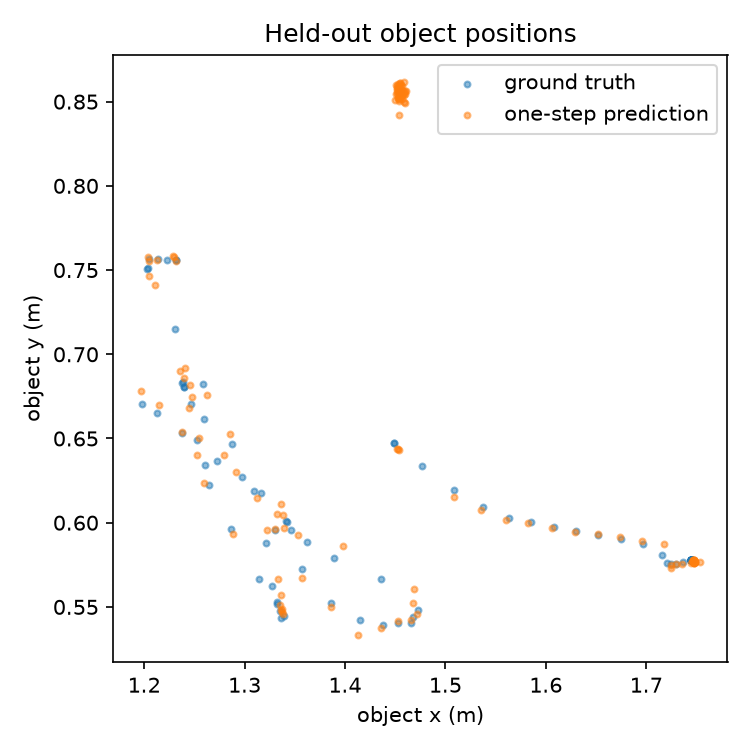
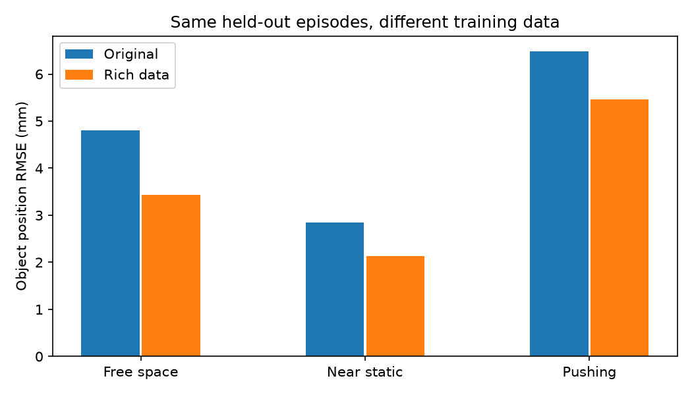
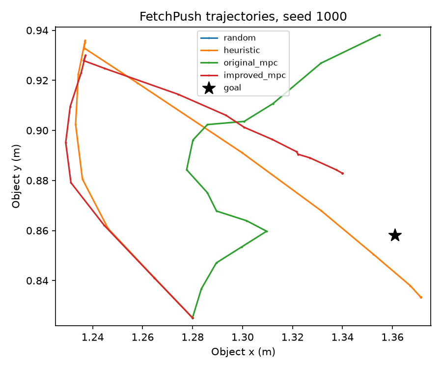
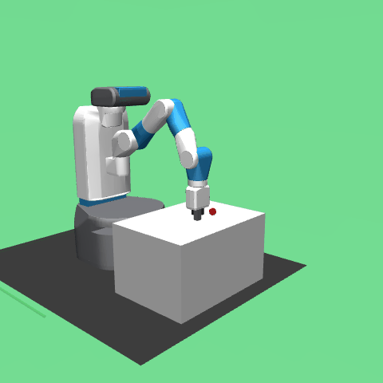

# Learning Robot Dynamics for Model-Based Manipulation

A small, CPU-first research implementation of a **state-based** world model for `FetchPush-v4`. A neural network learns one-step robot and object dynamics from MuJoCo trajectories. Cross-Entropy Method (CEM) model predictive control (MPC) searches action sequences under that learned model and replans after every real simulator step. This is a simulation study; no physical robot or sim-to-real result is claimed.

## Quick start

```bash
python3.12 -m venv .venv
source .venv/bin/activate
pip install -r requirements-lock.txt
pip install -e .
rwm probe --gif results/probe.gif
rwm collect --episodes 18 --seed 7 --steps 50
rwm train --epochs 35 --seed 7
rwm predict
rwm evaluate --seeds 100 101 102 --gif results/mpc.gif
pytest -q
```

`rwm probe` checks reset, one step, reward, spaces, and optional RGB rendering. If graphics are unavailable, omit `--gif`; physics, training, and planning can still run headlessly. The small reference dataset, checkpoint, plot, metrics, and MPC GIF are committed; new smoke outputs stay local.

For a faster end-to-end check, run `bash scripts/smoke.sh`. It uses 12 episodes, 18 training epochs, two evaluation seeds, and a smaller CEM search.

**Phase 2:** `bash scripts/phase2.sh` regenerates the larger dataset, model, regime diagnostics, four-policy comparison on 30 held-out seeds, and tests. It takes minutes on the tested M1 Pro CPU. To inspect the committed results immediately, open the linked artifacts below.

## Observation and action contract

The environment returns a dictionary: `observation` (25 floats), `achieved_goal` (current object XYZ), and `desired_goal` (target object XYZ). The action is `[gripper_dx, gripper_dy, gripper_dz, gripper_command]`, each in `[-1,1]`. The gripper is locked for FetchPush, so the fourth command is always zero here. Sparse reward is `0` inside 5 cm of the goal and `-1` otherwise. One environment step runs 20 MuJoCo substeps (0.04 s total).

| Raw `observation` indices | Meaning |
| --- | --- |
| 0–2 | Gripper Cartesian XYZ position in world coordinates (m) |
| 3–5 | Object Cartesian XYZ position in world coordinates (m) |
| 6–8 | Object position relative to gripper (m) |
| 9–10 | Right and left gripper finger joint displacements (m) |
| 11–13 | Object XYZ Euler orientation (rad) |
| 14–16 | Object linear velocity relative to gripper, scaled by step duration |
| 17–19 | Object angular velocity, scaled by step duration |
| 20–22 | Gripper linear velocity, scaled by step duration |
| 23–24 | Finger velocities, scaled by step duration |

The model uses a 12-D state: gripper XYZ, object XYZ, object XYZ *per-step displacement*, and gripper XYZ *per-step displacement*. Absolute object displacement is raw indices `14:17 + 20:23`. This drops redundant relative positions and the locked finger state. The goal is stored with transitions and enters the controller cost; it is never a model input. The 12-D observation omits some joint and contact details, so its dynamics need not be perfectly Markovian.

## Learning and planning

`data.py` records `(state, action, next_state, goal, episode_id, episode_seed, timestep, sampler)` from real FetchPush rollouts. One third of episodes use uniform random Cartesian actions; the rest use a noisy push heuristic that approaches behind the block. Whole episodes are assigned to train, validation, or test, preventing adjacent transitions from crossing splits.

`model.py` learns a residual: `s_hat[t+1] = s[t] + MLP(normalize([s[t], a[t]])) * delta_std + delta_mean`. All normalization statistics are fit on training episodes only. The checkpoint stores weights and statistics together; validation loss selects the best epoch. `prediction.py` compares held-out one-step RMSE with a zero-change predictor and measures open-loop object position RMSE after five real recorded actions, with no state correction between predictions.

`mpc.py` samples bounded action sequences, rolls them forward **only through the learned MLP**, scores predicted object-to-goal distance plus hand designed gripper placement and action costs, and updates the CEM sampling distribution using its best candidates. It executes only the first chosen action in MuJoCo, observes the result, and replans. The planner never queries hidden simulator futures. `rwm evaluate` runs random, heuristic, and learned MPC policies from identical test reset seeds, reporting final success, final distance, and planning time. Model bias and compounding error can make learned MPC worse than the heuristic; retain that result as evidence.

Phase 2 preserves this original controller and checkpoint. `phase2.py` adds four episode-level samplers: random, goal-directed with a stop inside the goal, near-contact action perturbations, and deliberately aggressive pushes. The data also records MuJoCo gripper/object contact at the **end** of each environment step and a separate moving-push label (object moves >2 mm while the gripper is within 10 cm). The latter catches short contacts during the 20 internal substeps, but is an operational proxy rather than an exact collision trace. All split assignments are by episode and stratified by sampler.

`improved_mpc.py` uses current observed geometry to move the gripper 5.5 cm behind the object, descends to about 1.5 cm above its center, and then uses CEM over a restricted forward-push action family. **Every candidate future in the push phase is predicted by the learned MLP.** The hand designed cost rewards goal progress and contact geometry and penalizes predicted object motion when the gripper is far away. This is a hybrid geometric approach plus learned-model MPC push controller; its success cannot be attributed solely to learned dynamics. MuJoCo is never queried for candidate future states.

## Phase 1 reference results

Measured on an Apple M1 Pro CPU with Python 3.12, PyTorch 2.14.1, MuJoCo 3.4.0, and Gymnasium-Robotics 1.4.2. The reference run collected 18 episodes × 50 steps = 900 transitions (600 train / 150 validation / 150 test), seeded at 7. About 30.8% of transitions had the gripper within 6.5 cm of the object. The best checkpoint was epoch 30 of 35, with normalized validation MSE 0.2868.

| Held-out prediction | Error |
| --- | ---: |
| Learned model, one-step object position RMSE | 0.00469 m |
| Zero-change baseline, one-step object position RMSE | 0.01273 m |
| Learned model, five-step open-loop object position RMSE | 0.03162 m |

Closed-loop policy comparison used identical reset seeds 100, 101, 102 and 50 steps per episode. These three episodes are a smoke test, not a reliable success-rate estimate.

| Policy | Final success | Mean final object-goal distance | Time to plan each step | Fraction of steps within 6.5 cm of object |
| --- | ---: | ---: | ---: | ---: |
| Random | 0/3 | 0.1783 m | — | 0.000 |
| Push heuristic | 0/3 | 0.1063 m | — | 0.653 |
| Learned dynamics + CEM-MPC | 0/3 | 0.1802 m | 2.39 ms | 0.073 |

The learned MPC executed real actions but rarely brought the gripper close enough to the object. Its short model horizon and imperfect contact predictions likely let the optimizer favor actions that look useful in the model but do not produce physical contact. The heuristic contacted and moved the object much more often, yet also failed to reach the 5 cm success threshold; its repeated approach/push rule can overshoot or oscillate. The initial 12-episode smoke model was worse still: one-step object RMSE 0.0251 m versus 0.0148 m for zero change, and five-step RMSE 0.1974 m. Its held-out episodes differ from the 18-episode run, so this is a warning about small-sample instability rather than a controlled learning-curve comparison.

Artifacts: [sample dataset](data/small.npz), [model checkpoint](results/dynamics.pt), [training history](results/train.json), [prediction metrics](results/prediction.json), [ground-truth comparison plot](results/prediction.png), [policy evaluation](results/evaluation.json), and [MPC rollout GIF](results/mpc.gif). These are genuine results from the commands above, including failures.




## Phase 2 diagnosis and results

On developer seeds 200–204, the original MPC predicted 3.35 mm mean object motion per **free-space** action while the simulator produced only 0.14 mm; 21% of such steps predicted >5 mm while actual motion was <1 mm. Its 8-step horizon also spans approach, descent, and push, leaving little lookahead for useful contact. The original heuristic sometimes entered the 5 cm success region and then pushed the object out again. A 4.5 cm stopping margin made the corrected heuristic succeed on 18/20 developer seeds 200–219. No final test seed was used to choose the controller or training recipe.

The phase-2 collection used seed 5000 and 120 episodes: 5,029 transitions (3,048 train / 1,003 validation / 978 test), including 1,947 moving-push transitions and 507 end-step MuJoCo contact detections. The model architecture and 35-epoch training schedule stayed the same, isolating the main data change. A tested contact-weighted objective only marginally improved validation near-contact error and slightly worsened free-space error, so the final model uses the original unweighted loss.

The table evaluates **both models on the same rich-data test episodes**. Zero-change is computed on those same transitions. Multi-step predictions use recorded actions but never reset the model to real intermediate states.

| Object position RMSE | Zero-change | Original model | Rich-data model |
| --- | ---: | ---: | ---: |
| One-step, all (978) | 11.65 mm | 5.09 mm | 3.98 mm |
| One-step, free space (472) | 10.67 mm | 4.81 mm | 3.43 mm |
| One-step, near-contact static (202) | **0.39 mm** | 2.84 mm | 2.13 mm |
| One-step, actual pushing (304) | 16.13 mm | 6.49 mm | 5.46 mm |
| Five-step, all (883 windows) | 49.99 mm | 35.18 mm | 26.49 mm |
| Five-step, starts in pushing (274) | 73.88 mm | 45.04 mm | 37.47 mm |

The near-contact static row remains a clear model failure: both MLPs hallucinate some motion when the block stays still. Five-step push error is still much larger than one-step error, so CEM can remain sensitive to model bias. The [full prediction metrics](results/phase2_prediction.json) include motion calibration and the other five-step regimes.

To separate model and planner effects, a [2 × 2 ablation](results/phase2_dev_ablation.json) used only developer seeds 200–219:

| Planner / model | Final success | Mean final distance |
| --- | ---: | ---: |
| Original CEM / original model | 5/20 | 0.1367 m |
| Original CEM / rich-data model | 13/20 | 0.1046 m |
| Contact-aware CEM / original model | 20/20 | 0.0264 m |
| Contact-aware CEM / rich-data model | 20/20 | 0.0272 m |

Thus the staged approach and contact-aware action search explain most of the observed control improvement on these developer seeds. The richer dataset improves prediction and helps the original planner, but these experiments do **not** establish that the richer model is necessary for the improved planner's success. No 2 × 2 ablation was run on final test seeds.

The final policy test used the **same 30 reset seeds, 1000–1029**, with 50 steps per episode. Two resets were already inside the 5 cm goal threshold; the corrected success rate excludes those two.

| Policy | Final success | New successes / 28 initially unsolved | Final distance | Near-object steps (<6.5 cm) | MuJoCo end-step contact | Planning time |
| --- | ---: | ---: | ---: | ---: | ---: | ---: |
| Random | 2/30 | 0/28 | 0.1581 m | 0.8% | 0.0% | — |
| Corrected heuristic | 24/30 | 22/28 | 0.1008 m | 24.1% | 5.9% | — |
| Original learned MPC | 4/30 | 2/28 | 0.1576 m | 17.1% | 8.8% | 2.23 ms/step |
| Improved learned MPC | **28/30** | **26/28** | **0.0648 m** | 44.6% | 6.7% | 0.40 ms/step overall |

The improved controller runs CEM only while pushing; its mean across **172 actual push-planning steps** is **3.42 ms**. The lower overall figure includes cheap approach and hold steps. The two failed test seeds, 1003 and 1029, ended 0.566 m and 0.674 m from the goal; after large block displacement the controller spent most of the remaining episode trying to reapproach. The heuristic achieved success at some point in 28/30 episodes but ended successful in 24/30, showing why final success and transient success must be distinguished. These are simulation-only results on 30 seeds, not a guarantee of robust control.

Phase-2 artifacts: [dataset](data/rich.npz), [model](results/rich.pt), [training history](results/phase2_train.json), [prediction comparison](results/phase2_prediction.json), [four-policy evaluation](results/phase2_evaluation.json), [regime error plot](results/phase2_regimes.png), [test trajectory plot](results/phase2_trajectories.png), and [improved MPC GIF](results/phase2_mpc.gif).







## Source and license

Original project code is MIT licensed; see [LICENSE](LICENSE). The environment is [Gymnasium-Robotics FetchPush](https://robotics.farama.org/envs/fetch/push/) (MIT), based on [Plappert et al., 2018](https://arxiv.org/abs/1802.09464). Physics uses [MuJoCo](https://mujoco.readthedocs.io/) (Apache 2.0). PyTorch supplies the MLP. These dependencies are installed separately and are not copied into this repository.
